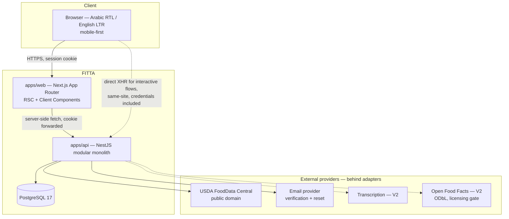
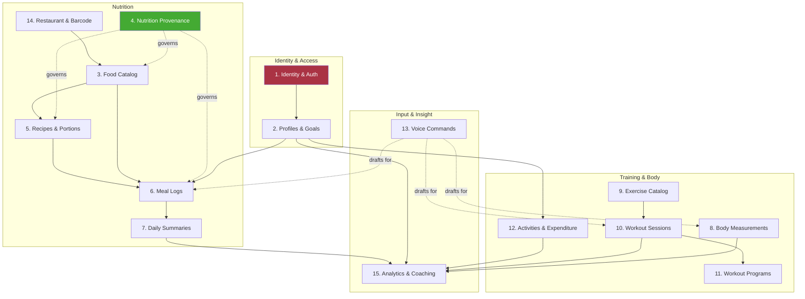

# FITTA — Architecture

**Status:** Phase 00 draft, awaiting approval
**Last updated:** 2026-10-28

This document describes the intended shape of the system. Decisions and their alternatives live in
`DECISIONS.md`; entities live in `DATA_MODEL.md`.

---

## 1. System context



**The rule the diagram encodes:** the browser never talks to an external provider, and never holds a
provider credential. Every outbound integration leaves from `apps/api`, through an adapter, with the
secret on the server.

## 2. Domain boundaries

Fifteen domains, grouped into four bounded contexts. The grouping matters because it tells us where
a module boundary is cheap to cross and where it must stay rigid.



### 2.1 Reading the diagram

- **Domain 4 (Provenance) is green because it is not a feature — it is a constraint on three other
  domains.** It has almost no endpoints of its own. It is a policy enforced in the schema.
- **Domain 1 (Identity) is red because it is upstream of everything.** Every other domain's
  authorization derives from the session it establishes. It is the one domain where a mistake is
  unrecoverable by later work.
- **Dotted arrows are "produces a proposal for", not "writes to".** Voice (13) never writes a meal
  log. It writes a draft that a user approves, and the approval path goes through the same
  validation as manual entry.
- **Domain 7 (Summaries) points only outward.** It is derived. Nothing may treat it as a source of
  truth (ADR-008).

### 2.2 Dependency rules

1. `Nutrition` and `Training` **must not** import each other. They meet only in `Analytics` (15).
2. Every domain that stores user-owned rows depends on `Identity` for the authenticated principal,
   and on nothing else in `Identity`.
3. `Analytics` (15) is read-only across all domains. It never writes domain data.
4. Catalog domains (3, 9) are readable by all authenticated users and writable only by
   `catalog:write`. They contain no user-owned rows.
5. A cycle between modules is a design error, not something to resolve with a forward reference.

## 3. Backend structure

```
apps/api/src/
├── main.ts
├── app.module.ts
├── config/                      # validated env (Zod) — fails fast on boot
├── common/
│   ├── guards/                  # SessionGuard, PermissionGuard, CsrfGuard
│   ├── decorators/              # @CurrentUser(), @Permissions()
│   ├── filters/                 # global exception → consistent error envelope
│   ├── interceptors/            # request-id, structured logging, redaction
│   ├── pipes/                   # global ValidationPipe (whitelist + forbidNonWhitelisted)
│   └── prisma/                  # PrismaService
├── modules/
│   ├── auth/                    # D1
│   ├── users/                   # D1
│   ├── profiles/                # D2
│   ├── goals/                   # D2
│   ├── energy/                  # D2 — pure calculation domain (BMI/BMR/TDEE/MET)
│   ├── foods/                   # D3 + D4
│   ├── portions/                # D5
│   ├── recipes/                 # D5 (V1.5)
│   ├── meal-logs/               # D6
│   ├── nutrition-summary/       # D7
│   ├── measurements/            # D8
│   ├── exercises/               # D9
│   ├── workouts/                # D10
│   ├── programs/                # D11 (V1.5)
│   ├── activities/              # D12
│   ├── voice/                   # D13 (V2)
│   ├── analytics/               # D15
│   └── providers/               # external adapters, one folder per provider
│       ├── usda/
│       ├── email/
│       └── transcription/       # V2
└── prisma/
    ├── schema.prisma
    ├── migrations/
    └── seed/
```

### 3.1 The layering rule inside a module

```
Controller   → HTTP only: route, DTO binding, status code, OpenAPI decoration.
             → Contains no `if` statement about business meaning.
Service      → Business workflow. Owns the transaction boundary. Scopes every query by userId.
Domain fn    → Pure calculation. No I/O, no Prisma, no Date.now(). Trivially unit-testable.
Prisma       → Data access. Called from services.
```

**`energy/` is deliberately a module of pure functions.** `calculateBmr(sex, kg, cm, age)` takes no
database, no request, and no clock. That is what makes it testable against published reference
values, and it is why the medical-safety rules in `PRD.md` §P4 are enforceable rather than aspirational.

### 3.2 Where authorization lives

Two layers, both mandatory:

1. **Guard** — is there a valid session, and does the principal hold the required permission?
2. **Service query scope** — every `where` clause on a user-owned table includes `userId` from the
   authenticated context.

Layer 2 is not redundant. A guard proves _who you are_; the query scope proves _which rows you may
touch_. A guard cannot know that `sessionId=abc` belongs to a different user — only the query can.

> **The single most important rule in this codebase:** `userId` is read from the session, never from
> the request body, query string, or path. A DTO that contains a `userId` field is a bug.

## 4. Frontend structure

```
apps/web/
├── app/
│   ├── [locale]/                # ar | en — dir=rtl|ltr set here
│   │   ├── (marketing)/         # public: landing, ephemeral calculators
│   │   ├── (auth)/              # login, register, reset
│   │   └── (app)/               # authenticated shell
│   │       ├── dashboard/
│   │       ├── food/
│   │       ├── diary/
│   │       ├── body/
│   │       ├── training/
│   │       └── settings/
├── components/
│   ├── ui/                      # shadcn primitives
│   └── features/                # domain components
├── lib/
│   ├── api/                     # typed client over packages/contracts
│   └── i18n/
└── e2e/                         # Playwright
```

### 4.1 Rendering policy

| Surface                                    | Rendering                   | Why                                                                              |
| ------------------------------------------ | --------------------------- | -------------------------------------------------------------------------------- |
| Marketing, catalog browse, exercise detail | **RSC**, cached             | Public, read-heavy, SEO matters, no per-user state                               |
| Dashboard shell, diary day view            | **RSC** for first paint     | Fast first byte with the user's real data already in the HTML                    |
| Food search, meal logging, set logging     | **Client + TanStack Query** | Debounced input, optimistic writes, retry — this is interaction, not a page load |
| Charts                                     | **Client**                  | Needs measurement and interaction                                                |

The split is per-surface, not per-app. See ADR-007.

### 4.2 RTL is a layout concern, not a translation concern

`dir` is set at the `[locale]` layout. Styling uses logical properties (`margin-inline-start`, not
`margin-left`) so one stylesheet serves both directions. Numerals, dates, and units are formatted
through `Intl`, never concatenated. Charts must mirror their axis direction in RTL — this is a known
source of silent bugs and gets an explicit Playwright check.

## 5. Repository layout

```
FITTA/                                 # single repo — ADR-006
├── CLAUDE.md
├── docs/
├── apps/
│   ├── api/
│   └── web/
├── packages/
│   ├── contracts/                     # Zod schemas = the single source of API truth
│   └── config/                        # shared tsconfig + eslint
├── pnpm-workspace.yaml
├── docker-compose.yml                 # postgres (dev) + postgres (test, separate port)
└── .github/workflows/ci.yml
```

`packages/contracts` is the keystone. A Zod schema there produces both the backend DTO validation
and the frontend's inferred TypeScript type. One definition, enforced at runtime on the server and
at compile time on the client.

## 6. Cross-cutting conventions

| Concern                    | Convention                                                                                           |
| -------------------------- | ---------------------------------------------------------------------------------------------------- |
| **IDs**                    | UUIDv7 or CUID2 — never sequential integers on user-owned rows (NEG-04)                              |
| **Money/decimals**         | No money in V1. Nutrient amounts are `Decimal`, never `float`                                        |
| **Units**                  | Metric canonical: kg, cm, g, ml, kcal, seconds. Conversion is presentation only (ADR-011)            |
| **Time**                   | `timestamptz` for instants; a separate `local_date` + `timezone` for day-bucketed data (ADR-010)     |
| **Errors**                 | One envelope: `{ error: { code, message, details?, requestId } }`. `code` is a stable machine string |
| **Not-found vs forbidden** | A resource the caller does not own returns **404**, not 403 — 403 confirms existence                 |
| **Logging**                | Structured JSON, request ID, user ID. A redaction allowlist, tested                                  |
| **Migrations**             | Forward-only, versioned, reviewed. Destructive changes are a two-step deploy                         |
| **Soft delete**            | Only where a product reason exists. Not a default                                                    |

## 7. The most dangerous early design mistakes

Ordered by cost of discovering them late. This section is the real output of Phase 00.

### 7.1 Joining meal logs to the live food catalog

**The mistake:** `meal_log_item` stores `food_id`, and the daily total is a join to
`food_nutrient`.

**Why it is fatal:** The day an administrator corrects koshary from 420 to 380 kcal per plate,
every user's historical diary silently rewrites itself. A user who hit their target last March now
didn't. Their weight-loss history stops reconciling with their intake history. There is no
migration that recovers the truth, because the truth was never stored.

**The fix:** snapshot the nutrient values onto the log item at write time (ADR-009). Costs a few
hundred bytes per row. Buys permanent historical integrity.

### 7.2 Deriving the diary day from a UTC timestamp

**The mistake:** store `logged_at timestamptz` and compute the diary date as `logged_at::date`.

**Why it is fatal:** A Cairo user logging a late dinner at 01:00 EET lands on the previous UTC date.
Their day shows two dinners and no breakfast. During DST transitions a day has 23 or 25 hours and
totals are wrong in a way that looks like a user error. Fixing it later requires replaying every row
through a timezone you did not record.

**The fix:** store the user's `local_date` explicitly alongside the instant and the timezone
(ADR-010).

### 7.3 Trusting a client-supplied `userId`

**The mistake:** `POST /meal-logs { userId, foodId, ... }` and the service writes what it is given.

**Why it is fatal:** It is a complete authorization bypass reachable with `curl`. It is also
unfixable by review alone, because it reads as perfectly ordinary code.

**The fix:** `userId` is structurally absent from every DTO, supplied only by `@CurrentUser()`. The
architectural test asserts that no request DTO declares a `userId` field.

### 7.4 Storing nutrition without provenance

**The mistake:** `food_nutrient(food_id, nutrient_id, amount)` with no source column.

**Why it is fatal:** You cannot add provenance later, because the information was never captured.
You would be guessing retroactively about where each number came from — which is exactly the
dishonesty the product exists to fix. And `NULL` vs `0` becomes unrecoverable: once an unknown
protein value has been written as `0`, you cannot tell it from a genuine zero.

**The fix:** provenance and source are `NOT NULL` from the first migration; unknown is `NULL`
(ADR-012).

### 7.5 One nutrition basis per food, chosen implicitly

**The mistake:** some foods store per 100 g, some per serving, some per 100 ml, and the code infers
which from context.

**Why it is fatal:** Every calculation becomes conditional, the conditions are undocumented, and a
liquid stored per 100 ml silently becomes per 100 g somewhere in the pipeline. Errors are quiet and
plausible.

**The fix:** **per 100 g, always**, with an explicit `density_g_per_ml` for liquids. One basis, no
exceptions.

### 7.6 Letting "admin" mean "can read everything"

**The mistake:** an `isAdmin` boolean that unlocks every query.

**Why it is fatal:** Catalog curation is a frequent, low-trust operation. Health data is
special-category personal data. Bundling them means every person who fixes a portion weight can read
every user's body-fat history. The first breach is a reportable one.

**The fix:** named permissions, and `support:read_user` does not exist in V1 (PRD §3.1).

### 7.7 Building screens before the data model settles

**The mistake:** start with the diary UI because it is visible and motivating.

**Why it is fatal:** The UI will encode assumptions — that a log item has one food, that a portion is
a string, that a day is a date, that nutrition is a flat object. When the schema lands, the
components, the forms, the validation, the tests, and the fixtures all change together. You rewrite
the fun part twice and the second time it is not fun.

**The fix:** this document, then the schema, then vertical slices.

### 7.8 Premature microservices or a generic "service framework"

**The mistake:** separating nutrition and training into deployable services, or building a
`BaseCrudService<T>` to avoid repetition.

**Why it is fatal:** Microservices convert a type error into a network error and a transaction into
a distributed-consistency problem, for a product with one developer and no scaling pressure. Generic
CRUD abstractions fit until the first real rule — "a goal may be active only if no other goal is
active" — and then every subclass fights the base class.

**The fix:** modular monolith (ADR-002); write the third duplicate before extracting the
abstraction.

### 7.9 Treating Arabic search as a `LIKE '%x%'` problem

**The mistake:** assume search is easy, discover late that it is the product.

**Why it is fatal:** The entire value proposition in `PRD.md` §1 is "find the food you mean". Arabic
orthographic variation, Franco-Arabic transliteration, and the absence of an Arabic stemmer in stock
PostgreSQL mean this needs a normalization pipeline and a trigram index designed in, not retrofitted
onto a schema with no normalized column.

**The fix:** ADR-012 defines the normalization and index strategy before the first food row exists.

## 8. What we are explicitly not building

| Not building                                 | Instead                                                                        |
| -------------------------------------------- | ------------------------------------------------------------------------------ |
| A message queue / background worker (V1)     | Synchronous request handling; revisit when export or provider sync needs it    |
| A caching layer (Redis)                      | PostgreSQL + HTTP cache headers; add when a measured query is slow             |
| An event bus / CQRS                          | Direct service calls inside the monolith                                       |
| A generic repository abstraction over Prisma | Prisma _is_ the abstraction; add a repository only where a genuine seam exists |
| Multi-tenancy                                | FITTA is multi-**user**, single-tenant. Users are not tenants                  |
| A feature-flag service                       | Environment config                                                             |
| Server-side rendering of charts              | Client-side                                                                    |
