# FITTA — Domain and Data Model

**Status:** Phase 00 draft (preliminary — not a schema). Awaiting approval.
**Last updated:** 2026-10-28

This is a conceptual model. Column types, exact names, and index definitions are settled per phase in
the Prisma schema. Nothing here is implementation.

**Legend:** 🌍 global/shared · 👤 user-owned · 🔒 special-category health data · ⏳ deferred past V1

---

## 0. Conventions that apply to every domain

| Rule                      | Statement                                                                                                                                                                                                      |
| ------------------------- | -------------------------------------------------------------------------------------------------------------------------------------------------------------------------------------------------------------- |
| **R1 — Ownership column** | Every 👤 table has a non-null `user_id` FK, and its primary index leads with `user_id`. Nested tables (e.g. `exercise_set`) reach `user_id` through at most one parent, and services scope at the owning root. |
| **R2 — Ownership source** | `user_id` is written from the authenticated session. No DTO contains a `userId` field, ever.                                                                                                                   |
| **R3 — Identifiers**      | UUIDv7/CUID2 on user-owned rows. Never sequential integers (NEG-04).                                                                                                                                           |
| **R4 — Units**            | Metric canonical (ADR-011). `entered_unit` is display metadata only.                                                                                                                                           |
| **R5 — Day bucketing**    | `logged_at timestamptz` + `local_date date` + `timezone` (ADR-010).                                                                                                                                            |
| **R6 — Unknown**          | A missing nutrient is `NULL`. `0` means measured zero. These are never conflated.                                                                                                                              |
| **R7 — Deletion**         | 👤 rows cascade from `user`. 🌍 rows never cascade from a user.                                                                                                                                                |
| **R8 — Decimals**         | Nutrient amounts and body measurements are `Decimal`, never `float`.                                                                                                                                           |

---

## 1. Identity and Authentication 🔒

**Responsibility.** Establish and prove who is making a request. Nothing else. It does not know what
a meal or a workout is.

### Entities

| Entity                          | Scope | Key fields                                                                                                       | Notes                                                                                                                     |
| ------------------------------- | ----- | ---------------------------------------------------------------------------------------------------------------- | ------------------------------------------------------------------------------------------------------------------------- |
| `User`                          | 👤    | `id`, `email` (citext, unique), `password_hash`, `status`, `email_verified_at`, `created_at`                     | `password_hash` is Argon2id. Email stored case-insensitively to prevent duplicate-account-by-case.                        |
| `Session`                       | 👤    | `id`, `user_id`, `token_hash`, `created_at`, `expires_at`, `revoked_at`, `last_seen_at`, `ip_hash`, `user_agent` | The cookie carries a random opaque token; only its **hash** is stored, so a database read does not yield usable sessions. |
| `PasswordResetToken`            | 👤    | `id`, `user_id`, `token_hash`, `expires_at`, `consumed_at`                                                       | Single-use, ≤30 min.                                                                                                      |
| `EmailVerificationToken`        | 👤    | `id`, `user_id`, `token_hash`, `expires_at`, `consumed_at`                                                       |                                                                                                                           |
| `AuthEvent`                     | 👤    | `id`, `user_id?`, `type`, `occurred_at`, `ip_hash`, `outcome`                                                    | Audit trail. `user_id` nullable: a failed login for an unknown email has no user. Never stores the attempted password.    |
| `Permission` / `UserPermission` | 🌍/👤 | `code`, `user_id`                                                                                                | Named permissions (`catalog:write`, `content:review`), not a role enum. PRD §3.1.                                         |

### Relationships

`User 1—* Session`, `User 1—* AuthEvent`, `User *—* Permission`.

### Invariants

- `email` is unique after normalization (lowercase, trimmed).
- A session is valid iff `revoked_at IS NULL AND expires_at > now()`. There is no other definition.
- Password reset consumption revokes **all** of that user's sessions (US-04 AC3).
- Login issues a **new** session id and invalidates any pre-authentication one (session fixation).
- `AuthEvent` is append-only.

### External dependencies

Email provider (verification, reset) — behind an `EmailProvider` interface with a console adapter for
development and a deterministic mock for tests.

### API boundary

`POST /auth/register`, `/auth/login`, `/auth/logout`, `GET /auth/session`,
`POST /auth/password/reset-request`, `/auth/password/reset`, `POST /auth/email/verify`,
`GET /auth/sessions`, `DELETE /auth/sessions/:id`.

### Privacy and security risks

| Risk                                                   | Mitigation                                                                                                   |
| ------------------------------------------------------ | ------------------------------------------------------------------------------------------------------------ |
| Account enumeration via register/login/reset responses | Identical response shape, status, and timing distribution across all three (US-01 AC2, US-02 AC1, US-04 AC1) |
| Timing side channel on password verification           | Always run the Argon2 verification, including against a dummy hash for unknown emails                        |
| Session fixation                                       | Rotate the session id on authentication                                                                      |
| Session theft via XSS                                  | `HttpOnly` cookie — the token is not reachable from JavaScript                                               |
| CSRF on state-changing requests                        | `SameSite=Lax` + double-submit token                                                                         |
| Credential stuffing                                    | Per-IP and per-account rate limiting with escalating delay                                                   |
| Token leakage through logs                             | Redaction allowlist, enforced by a unit test (NFR-12)                                                        |
| Database read yielding live sessions                   | Store `token_hash`, not the token                                                                            |

---

## 2. Profiles and Goals 🔒

**Responsibility.** Hold the physiological inputs to energy estimation, the user's goal, and the
derived targets. Owns the safety bounds.

### Entities

| Entity          | Scope | Key fields                                                                                                                                                        | Notes                                                                                                                                                                                             |
| --------------- | ----- | ----------------------------------------------------------------------------------------------------------------------------------------------------------------- | ------------------------------------------------------------------------------------------------------------------------------------------------------------------------------------------------- |
| `Profile`       | 👤🔒  | `user_id` (unique), `sex`, `birth_date`, `height_cm`, `activity_level`, `locale`, `timezone`, `unit_preference`                                                   | 1:1 with `User`. **Birth date, not age** — age is derived at calculation time, so it never goes stale.                                                                                            |
| `Goal`          | 👤🔒  | `id`, `user_id`, `type`, `start_weight_kg`, `target_weight_kg`, `rate_kg_per_week`, `started_at`, `ended_at`, `status`                                            | `type ∈ {LOSE_WEIGHT, MAINTAIN, GAIN_WEIGHT, GAIN_MUSCLE}`                                                                                                                                        |
| `CalorieTarget` | 👤🔒  | `id`, `user_id`, `goal_id`, `effective_from`, `bmr_kcal`, `tdee_kcal`, `target_kcal`, `protein_g`, `carb_g`, `fat_g`, `formula`, `inputs_snapshot`, `computed_at` | A **snapshot series**, not a mutable row. Changing your weight creates a new target; the old one remains so historical adherence is computable against the target that actually applied that day. |

> `sex` here is the biological input the Mifflin-St Jeor equation requires. It is a calculation
> parameter, labeled as such in the UI, and deliberately separate from any notion of identity.

### Relationships

`User 1—1 Profile`, `User 1—* Goal`, `Goal 1—* CalorieTarget`.

### Invariants

- At most one `Goal` with `status = ACTIVE` per user — enforced by a **partial unique index** on
  `(user_id) WHERE status = 'ACTIVE'`, not by application logic alone.
- `rate_kg_per_week ≤ min(1.0, 0.01 × current_weight_kg)`.
- `target_kcal ≥ 1200` (female) / `≥ 1500` (male), and `≥ bmr_kcal` unless separately acknowledged.
- `target_weight_kg` must not imply BMI < 18.5.
- `height_cm ∈ [80, 250]`; `birth_date` implies age ∈ [16, 100].
- `CalorieTarget` rows are immutable once written.

### External dependencies

None. Formulae (Mifflin-St Jeor, Katch-McArdle if body fat is known) are pure functions in
`modules/energy`.

### API boundary

`GET/PUT /me/profile`, `GET/POST /me/goals`, `PATCH /me/goals/:id`, `GET /me/targets/current`,
`POST /public/calculators/bmi|tdee` (ephemeral, unauthenticated, **persists nothing**).

### Privacy and security risks

Sex, birth date, height, and weight together are special-category health data and a strong
re-identification set. Never logged (NFR-12). Never exposed in any aggregate without k-anonymity.
The public calculator endpoint must be rate-limited and must not write to the database.

---

## 3. Food Catalog 🌍

**Responsibility.** Be the authoritative, searchable, Egyptian-first list of foods and their
nutrition per 100 g. This is the product's hardest and most valuable domain.

### Entities

| Entity         | Scope | Key fields                                                                                                   | Notes                                                                                                                                                               |
| -------------- | ----- | ------------------------------------------------------------------------------------------------------------ | ------------------------------------------------------------------------------------------------------------------------------------------------------------------- |
| `Food`         | 🌍    | `id`, `category_id`, `brand_id?`, `state`, `density_g_per_ml?`, `is_public`, `created_by_user_id?`, `status` | `state ∈ {RAW, COOKED, PREPARED}` — **critical**: raw vs cooked rice differs ~3× by weight. `created_by_user_id` set for community submissions (V1.5).              |
| `FoodName`     | 🌍    | `id`, `food_id`, `locale`, `name_type`, `value`, `normalized`, `is_primary`                                  | Many per food. `name_type ∈ {OFFICIAL, COLLOQUIAL, TRANSLITERATION, SYNONYM, BRAND}`. `normalized` per ADR-012.                                                     |
| `FoodCategory` | 🌍    | `id`, `parent_id?`, `slug` + localized names                                                                 | Hierarchical.                                                                                                                                                       |
| `Brand`        | 🌍    | `id`, `name_ar`, `name_en`, `country`                                                                        |                                                                                                                                                                     |
| `Nutrient`     | 🌍    | `id`, `code`, `unit`, `display_order`, `is_macro`                                                            | `code ∈ {ENERGY_KCAL, PROTEIN_G, FAT_G, CARB_G, FIBER_G, SUGAR_G, SODIUM_MG, ...}`. Stable codes — code is the contract, `id` is an implementation detail.          |
| `FoodNutrient` | 🌍    | `food_id`, `nutrient_id`, `amount_per_100g`, `provenance`, `source_id`, `confidence`                         | **Per 100 g always** (ARCHITECTURE §7.5). `NULL` amount is not permitted — a missing nutrient has **no row**, which is how unknown stays distinguishable from zero. |
| `FoodPortion`  | 🌍    | `id`, `food_id`, `label_ar`, `label_en`, `gram_weight`, `is_default`, `provenance`                           | The Egyptian-portions feature: _طبق كشري_, _رغيف عيش بلدي_, _كوباية شاي_, _معلقة سكر_.                                                                              |
| `FoodSource`   | 🌍    | `id`, `name`, `license_type`, `attribution_text`, `url`, `caching_allowed`, `retrieved_at`                   | See §4.                                                                                                                                                             |

### Search design (ADR-012)

- `food_name.normalized` carries a `GIN (normalized gin_trgm_ops)` index.
- Query text passes through the **same** normalization function as write.
- Ranking: `similarity()` × a weight by `name_type` (official > colloquial > transliteration >
  synonym) × a popularity factor (log of log count).
- Extensions required: `pg_trgm`, `unaccent`.

### Invariants

- Every `FoodNutrient` row has a non-null `provenance` and `source_id` (ADR-012 / §4).
- Every `Food` has ≥1 `FoodName` with `is_primary = true` per supported locale.
- Exactly one `FoodPortion` per food may be `is_default`.
- `gram_weight > 0`; `amount_per_100g ≥ 0`.
- A food with `density_g_per_ml` is liquid; volume portions resolve through it, never by assuming
  1 ml = 1 g.
- `normalized` is always derived, never user-supplied.

### External dependencies

USDA FoodData Central (US public domain — safe to ingest and redistribute with attribution);
Egyptian food composition tables **only if licensing is verified** (RISK-05). A `FoodDataProvider`
interface with a mock adapter is mandatory.

### API boundary

`GET /foods/search`, `GET /foods/:id`, `GET /foods/:id/portions`, `GET /food-categories`,
`GET /nutrients`. Admin: `POST/PATCH /admin/foods`, `/admin/foods/:id/names`,
`/admin/foods/:id/nutrients`, `/admin/foods/:id/portions` — all behind `catalog:write`.

### Privacy and security risks

No personal data — but **search queries are personal**. A query log reveals diet, religion
(halal-adjacent queries), and health conditions. Search terms are not logged with a user id in V1.
Other risks: catalog poisoning via community submissions (mitigated by the V1.5 review queue), and
license violation through redistribution of data we have no right to redistribute (RISK-05).

---

## 4. Nutrition Provenance 🌍 — a policy, not a feature

**Responsibility.** Guarantee that every nutrition number in FITTA can answer "where did you come
from, and how much should I trust you?" This domain has almost no endpoints. It is a constraint
expressed in the schema and enforced everywhere.

### The provenance ladder

| Tier                     | Meaning                                                         | Example               | Display                                                   |
| ------------------------ | --------------------------------------------------------------- | --------------------- | --------------------------------------------------------- |
| `MANUFACTURER_CONFIRMED` | Transcribed from an official product label or manufacturer data | Juhayna milk 1 L      | Highest confidence badge                                  |
| `LAB_ANALYZED`           | Published laboratory analysis in a food-composition database    | USDA SR Legacy entry  | High                                                      |
| `RESEARCH_PUBLISHED`     | Peer-reviewed or national food-composition table                | Egyptian NNI table    | High                                                      |
| `RECIPE_CALCULATED`      | Computed from ingredient composition and a stated yield         | A FITTA koshary entry | Medium — confidence is the **minimum** across ingredients |
| `COMMUNITY_ESTIMATED`    | Submitted by a user and reviewed                                | A home-made dish      | Low — visually distinct                                   |
| `USER_PRIVATE`           | Entered by one user for their own use, never public             | "my mum's mahshi"     | Not shown to others                                       |

### Policy rules (binding)

1. Every `FoodNutrient` and `FoodPortion` row carries `provenance` and `source_id`, both `NOT NULL`,
   from the first migration. This cannot be retrofitted (ARCHITECTURE §7.4).
2. **A missing nutrient has no row.** It is rendered as "—" / "غير معروف", never `0` (R6, US-10 AC2).
3. A derived value's provenance is `RECIPE_CALCULATED` and its confidence is the **minimum** of its
   inputs. Confidence never increases through computation.
4. Nothing in FITTA may invent a nutrient value. If it is unknown, it stays unknown.
5. Attribution text required by a source's license is rendered wherever that data is displayed.
6. `caching_allowed` on `FoodSource` governs whether provider responses may be persisted at all.
7. A meal log snapshots the provenance tag that was true **at log time** (ADR-009), so a later
   promotion does not retroactively claim confidence the entry never had.

### Privacy and security risks

Mis-stating provenance is the product's core integrity failure — presenting a community guess as
manufacturer-confirmed is worse than showing nothing. It is also a legal exposure (license
attribution, and implied accuracy claims about health information).

---

## 5. Recipes and Portion Sizes ⏳ V1.5 (portions are V1)

**Responsibility.** Let composite foods be defined from ingredients, and let users log in units they
actually think in.

### Entities

| Entity             | Scope    | Key fields                                                                                                 | Notes                                                                         |
| ------------------ | -------- | ---------------------------------------------------------------------------------------------------------- | ----------------------------------------------------------------------------- |
| `Recipe`           | 👤 or 🌍 | `id`, `owner_user_id?`, `name_ar`, `name_en`, `servings`, `total_cooked_weight_g`, `visibility`, `version` | `owner_user_id IS NULL` ⇒ a public template. Not null ⇒ private to that user. |
| `RecipeIngredient` | —        | `id`, `recipe_id`, `food_id`, `quantity_g`, `portion_id?`, `portion_count?`                                | Resolves to grams at save time.                                               |
| `RecipeNutrition`  | —        | `recipe_id`, `nutrient_id`, `amount_per_100g`, `confidence`                                                | Derived; recomputed on edit; `RECIPE_CALCULATED`.                             |
| `UserPortion` ⏳   | 👤       | `id`, `user_id`, `food_id`, `label`, `gram_weight`                                                         | "my cup = 180 g".                                                             |

### Invariants

- A recipe's nutrition is **derived**, never typed in directly.
- `total_cooked_weight_g` is mandatory for cooked recipes. Without it, per-100 g nutrition for a dish
  that absorbed or lost water is wrong by a large factor — dry rice at ~360 kcal/100 g becomes
  ~130 kcal/100 g cooked. **This single field is the most common source of catastrophic recipe
  errors.**
- Editing a recipe increments `version` and **must not** alter existing meal log items (ADR-009).
- A private recipe becomes public only through explicit owner consent plus review.
- Ownership: `owner_user_id` is from the session (R2).

### API boundary

`GET/POST /me/recipes`, `GET/PATCH/DELETE /me/recipes/:id`, `GET /recipes/templates`.

### Privacy and security risks

Recipes can be personally identifying and culturally sensitive. Private by default. Promotion to
public requires consent and strips the owner link. The classic IDOR here is
`GET /recipes/:id` returning someone's private recipe — hence 404 for non-owned, non-public.

---

## 6. Meal Logs 👤🔒 — the heart of the product

**Responsibility.** Record what a user actually ate, immutably, with full provenance.

### Entities

| Entity         | Scope | Key fields                                                                                                                                                                                                                         | Notes                                                                                                             |
| -------------- | ----- | ---------------------------------------------------------------------------------------------------------------------------------------------------------------------------------------------------------------------------------- | ----------------------------------------------------------------------------------------------------------------- |
| `MealLogEntry` | 👤🔒  | `id`, `user_id`, `local_date`, `timezone`, `logged_at`, `meal_type`, `note?`                                                                                                                                                       | `meal_type ∈ {BREAKFAST, LUNCH, DINNER, SNACK}`. ADR-010.                                                         |
| `MealLogItem`  | 👤🔒  | `id`, `entry_id`, `source_type`, `food_id?`, `recipe_id?`, `quantity_g`, `portion_id?`, `portion_label_snapshot`, `portion_gram_weight_snapshot`, `nutrient_snapshot`, `provenance_snapshot`, `source_name_snapshot`, `created_at` | `source_type ∈ {FOOD, RECIPE, QUICK_ADD}`. The snapshot fields are ADR-009 and are the reason this table matters. |

### The snapshot, concretely

Logging "one plate of koshary (420 g)" writes: `food_id` (for "log again" and linking),
`quantity_g = 420`, `portion_label_snapshot = "طبق"`, `portion_gram_weight_snapshot = 420`, and a
`nutrient_snapshot` containing the per-item totals — energy, protein, carb, fat, and the rest — as
computed from the catalog _at that moment_, plus the provenance tag that was true then.

A catalog correction tomorrow changes `food_nutrient`. It does not touch this row. That is the
entire point (US-11).

### Indexes

`(user_id, local_date)` on `MealLogEntry` — the dominant access pattern.
`(entry_id)` on `MealLogItem`.

### Invariants

- `quantity_g > 0`.
- `source_type = FOOD ⇒ food_id NOT NULL`; `= RECIPE ⇒ recipe_id NOT NULL`;
  `= QUICK_ADD ⇒ both NULL` and the snapshot is user-supplied with provenance `USER_PRIVATE`.
- Snapshot fields are immutable after insert. An "edit" replaces the item (new snapshot), it does
  not mutate the old one.
- An item is reachable only through its entry, and the entry is always scoped by `user_id`.

### API boundary

`GET /me/diary?date=`, `POST /me/meal-logs`, `GET/PATCH/DELETE /me/meal-logs/:id`,
`POST /me/meal-logs/:id/items`, `PATCH/DELETE /me/meal-log-items/:id`.

### Privacy and security risks

**This is the highest-value IDOR target in the product.** A meal log is a detailed, timestamped
record of a person's eating behaviour — enough to infer disordered eating, pregnancy, religious
observance, and medical conditions. Mitigations: R1–R3; nested writes re-verify ownership at the
entry level; non-owned resources return **404**, not 403; non-sequential ids; and NEG-01 through
NEG-04 are mandatory tests.

---

## 7. Daily Nutrition Summaries 👤🔒 (derived)

**Responsibility.** Present a day's totals against the target that applied on that day.

### Model

**V1: no table.** Computed on read by aggregating `MealLogItem` through `MealLogEntry` for
`(user_id, local_date)`, joined against the `CalorieTarget` whose `effective_from` covers that date
(ADR-008).

If materialized later: `DailyNutritionSummary(user_id, local_date, kcal, protein_g, carb_g, fat_g,
item_count, computed_at, source_version)`.

### Invariants

- The summary is **always** reproducible from the logs. The logs are the source of truth, in either
  design.
- A day with no entries returns an explicit zeroed summary, not a 404 — "I ate nothing recorded" is
  a valid, meaningful answer.
- Adherence is computed against the target in force on that date, not today's target.

### API boundary

`GET /me/nutrition/daily?date=`, `GET /me/nutrition/range?from=&to=`.

### Privacy and security risks

Range endpoints must enforce a maximum span (e.g. 366 days) to prevent a cheap denial-of-service by
requesting a decade. Strictly user-scoped.

---

## 8. Body Measurements 👤🔒

**Responsibility.** Record body metrics over time and expose a trend that is honest about noise.

### Entities

| Entity                | Scope | Key fields                                                                                                          | Notes                                                                                                    |
| --------------------- | ----- | ------------------------------------------------------------------------------------------------------------------- | -------------------------------------------------------------------------------------------------------- |
| `BodyMeasurement`     | 👤🔒  | `id`, `user_id`, `type`, `value_metric`, `entered_unit`, `measured_at`, `local_date`, `timezone`, `source`, `note?` | `type ∈ {WEIGHT, WAIST, HIP, CHEST, ARM, THIGH, NECK, BODY_FAT_PCT}`; `source ∈ {MANUAL, DEVICE, VOICE}` |
| `ProgressPhoto` ⏳ V2 | 👤🔒  | `id`, `user_id`, `storage_key`, `taken_at`, `pose`                                                                  | Object storage, encrypted, short-lived signed URLs only. Never public.                                   |

**Why one table with a `type` enum** rather than columns per metric: measurement types are an open
set that will grow, and every new metric would otherwise be a migration plus a nullable column.
The cost is that cross-metric queries need pivoting — acceptable, because the dominant query is
"one metric over time", which this shape serves with a single index.

### Invariants

- Plausibility bounds per type (weight 25–400 kg; body fat 3–70%). Out-of-bounds is **rejected**.
- A day-over-day weight change > 3 kg **warns** but does not block — rapid change is real (illness,
  travel, fluid), and refusing it would make the app lie.
- Multiple measurements per day are allowed. Daily analytics use **the last measurement of the local
  day**, and this rule is documented in the UI rather than left implicit.
- Trend lines use a smoothed series (EMA, ~10-day) because daily scale weight is dominated by fluid
  noise; the UI states that the line is smoothed.

### API boundary

`GET /me/measurements?type=&from=&to=`, `POST /me/measurements`,
`PATCH/DELETE /me/measurements/:id`, `GET /me/measurements/trend?type=`.

### Privacy and security risks

Among the most sensitive data in the product, and the most psychologically loaded. Weight history
can indicate eating disorders and pregnancy. Never logged. Included in export, deleted on account
deletion. Progress photos (V2) are biometric-adjacent and require their own policy before a single
upload is accepted.

---

## 9. Exercise Catalog 🌍

**Responsibility.** A browsable, bilingual reference of exercises, their muscles, equipment, and
instructions.

### Entities

| Entity                | Scope | Key fields                                                                |
| --------------------- | ----- | ------------------------------------------------------------------------- |
| `Exercise`            | 🌍    | `id`, `slug`, `type`, `mechanic`, `force_type`, `difficulty`, `is_public` |
| `ExerciseName`        | 🌍    | `id`, `exercise_id`, `locale`, `value`, `normalized`, `name_type`         |
| `MuscleGroup`         | 🌍    | `id`, `slug`, `name_ar`, `name_en`, `body_region`                         |
| `ExerciseMuscle`      | 🌍    | `exercise_id`, `muscle_group_id`, `role` (`PRIMARY`/`SECONDARY`)          |
| `Equipment`           | 🌍    | `id`, `slug`, `name_ar`, `name_en`                                        |
| `ExerciseEquipment`   | 🌍    | `exercise_id`, `equipment_id`                                             |
| `ExerciseInstruction` | 🌍    | `id`, `exercise_id`, `locale`, `step_order`, `text`                       |
| `ExerciseMedia`       | 🌍    | `id`, `exercise_id`, `kind`, `url`, `license`, `attribution`, `source_id` |

`type ∈ {STRENGTH, CARDIO, MOBILITY, PLYOMETRIC}`; `mechanic ∈ {COMPOUND, ISOLATION}`;
`force_type ∈ {PUSH, PULL, STATIC}`.

### Invariants

- ≥1 `PRIMARY` muscle per strength exercise.
- Every `ExerciseMedia` row carries a license and attribution — **no unlicensed media, ever**
  (RISK-06).
- Arabic names use the same normalization pipeline as foods (ADR-012) — one function, two domains.

### External dependencies

MuscleWiki is listed as a _potential_ source, and its terms are **unverified**. V1 ships a curated
seed catalog behind an `ExerciseDataProvider` interface with a mock adapter. **No scraping, no
hotlinking.** (RISK-06.)

### API boundary

`GET /exercises`, `GET /exercises/:id`, `GET /muscle-groups`, `GET /equipment`.
Admin: `POST/PATCH /admin/exercises...` behind `catalog:write`.

### Privacy and security risks

No personal data. Risks are licensing and media hotlinking (hosting cost and IP exposure).

---

## 10. Workout Sessions 👤

**Responsibility.** Record training performed, and derive personal records from it.

### Entities

| Entity            | Scope            | Key fields                                                                                                                                        | Notes                                                                                  |
| ----------------- | ---------------- | ------------------------------------------------------------------------------------------------------------------------------------------------- | -------------------------------------------------------------------------------------- |
| `WorkoutSession`  | 👤               | `id`, `user_id`, `status`, `started_at`, `completed_at?`, `local_date`, `timezone`, `duration_sec?`, `note?`                                      | `status ∈ {PLANNED, IN_PROGRESS, COMPLETED, ABANDONED}`                                |
| `SessionExercise` | 👤 (via session) | `id`, `session_id`, `exercise_id`, `order_index`, `note?`                                                                                         |                                                                                        |
| `ExerciseSet`     | 👤 (via session) | `id`, `session_exercise_id`, `set_index`, `reps?`, `weight_kg?`, `duration_sec?`, `distance_m?`, `rpe?`, `is_warmup`, `is_completed`, `rest_sec?` | Nullable metrics because a cardio set has no reps and a plank has no weight.           |
| `PersonalRecord`  | 👤               | `id`, `user_id`, `exercise_id`, `record_type`, `value`, `achieved_at`, `source_set_id`                                                            | `record_type ∈ {MAX_WEIGHT, MAX_REPS, MAX_VOLUME, EST_1RM}`. Derived and recomputable. |

### Invariants

- `ExerciseSet → SessionExercise → WorkoutSession.user_id` is the ownership path. **Every** mutation
  on a set re-verifies ownership at the session root — this two-hop path is the most likely place in
  the codebase for an authorization gap (NEG-03).
- `weight_kg ≥ 0`, `reps ≥ 0`; at least one metric is non-null.
- Warmup sets are excluded from PR and volume calculations.
- Estimated 1RM (Epley or Brzycki) is **an estimate**, labeled, with the formula named (PRD P4).
- PRs are derived — they must be fully recomputable from sets, never only incrementally updated.

### API boundary

`GET/POST /me/workouts`, `GET/PATCH/DELETE /me/workouts/:id`,
`POST /me/workouts/:id/exercises`, `POST /me/workout-exercises/:id/sets`,
`PATCH/DELETE /me/sets/:id`, `GET /me/records?exerciseId=`.

### Privacy and security risks

Training data reveals schedule and location patterns. The nested-ownership path is the top IDOR
risk after meal logs.

---

## 11. Workout Programs ⏳ V1.5

**Responsibility.** Prescribe structured multi-week training and track adherence.

### Entities

`Program` (🌍 template when `owner_user_id IS NULL`, else 👤), `ProgramWeek`, `ProgramDay`,
`ProgramExercise` (prescription: `target_sets`, `rep_range_low/high`, `target_rpe?`,
`percent_1rm?`), `ProgramEnrollment` 👤 (`user_id`, `program_id`, `program_version`, `start_date`,
`current_week`, `status`), `ProgramDayCompletion` 👤 (links to a `WorkoutSession`).

### Invariants

- **Programs are versioned, and an enrollment pins a version.** Editing a public template must not
  silently change the plan of a user who is three weeks into it. This is the same immutability
  principle as ADR-009, applied to prescriptions.
- A prescription is a target, never an automatically logged result.
- One active enrollment per user per program.

### API boundary

`GET /programs`, `GET /programs/:id`, `POST /me/enrollments`, `GET/PATCH /me/enrollments/:id`.

---

## 12. Activities and Expenditure 👤🔒

**Responsibility.** Estimate energy expended in non-training activity, honestly, and refuse to let
that estimate silently inflate the calorie budget.

### Entities

| Entity         | Scope | Key fields                                                                                                                                                     | Notes                                                             |
| -------------- | ----- | -------------------------------------------------------------------------------------------------------------------------------------------------------------- | ----------------------------------------------------------------- |
| `ActivityType` | 🌍    | `id`, `slug`, `name_ar`, `name_en`, `met_value`, `met_source_id`, `category`                                                                                   | MET values carry a citation.                                      |
| `ActivityLog`  | 👤🔒  | `id`, `user_id`, `activity_type_id`, `local_date`, `timezone`, `started_at`, `duration_min`, `intensity?`, `estimated_kcal`, `estimation_method`, `confidence` | `estimation_method ∈ {MET_FORMULA, DEVICE_REPORTED, USER_MANUAL}` |

### The calculation, stated explicitly

```
gross_kcal = MET × 3.5 × weight_kg / 200 × minutes
net_kcal   = (MET − 1) × 3.5 × weight_kg / 200 × minutes      ← FITTA uses this
```

Net, because the resting component is already inside BMR and therefore inside TDEE. Using gross
double-counts by 10–25% (ADR-013).

### Invariants

- `estimated_kcal` is **always** labeled an estimate with its method and source.
- It does **not** modify the day's calorie target. An opt-in credit is capped (default 50%) and is
  an explicit, informed setting (ADR-013).
- A device-reported value keeps its own provenance and is not recomputed by our formula.

### API boundary

`GET /activity-types`, `GET/POST /me/activities`, `PATCH/DELETE /me/activities/:id`.

### Privacy and security risks

Activity logs with timestamps are movement patterns. Medical-safety risk if estimates are presented
as measurements — hence the display rule in ADR-013.

---

## 13. Voice Commands ⏳ V2 🔒

**Responsibility.** Turn Egyptian Arabic speech into a **reviewable draft**. Never into a saved
record directly.

### Entities

| Entity         | Scope | Key fields                                                                                                                                                       | Notes                                                                                                  |
| -------------- | ----- | ---------------------------------------------------------------------------------------------------------------------------------------------------------------- | ------------------------------------------------------------------------------------------------------ |
| `VoiceCommand` | 👤🔒  | `id`, `user_id`, `created_at`, `locale`, `provider`, `model_version`, `transcript`, `transcript_confidence`, `audio_storage_key?`, `audio_retention_expires_at?` | Audio is **not stored by default**.                                                                    |
| `VoiceDraft`   | 👤🔒  | `id`, `command_id`, `user_id`, `intent`, `proposed_payload`, `status`, `resolved_entity_type?`, `resolved_entity_id?`, `expires_at`                              | `intent ∈ {LOG_MEAL, LOG_WORKOUT, LOG_MEASUREMENT}`; `status ∈ {PENDING, APPROVED, REJECTED, EXPIRED}` |

### Invariants

- **No draft becomes a record without explicit user approval.** This is a safety control, not a UX
  preference — a mis-transcribed "عشرة" vs "عشرين" is a 2× error in a health record.
- Approval runs the identical validation path as manual entry. There is no privileged write path.
- Raw audio: not retained by default. If retained (explicit opt-in), it is encrypted, TTL-bounded
  (≤7 days), and **never logged** (NFR-12).
- The transcript is health data.
- A draft expires; expired drafts cannot be approved.

### External dependencies

A transcription provider behind a `TranscriptionProvider` interface, with a deterministic mock for
tests. **Gated on a measured evaluation:** Egyptian colloquial Arabic accuracy must be assessed
against a held-out set of real food and workout utterances before any user sees this feature
(RISK-08).

### Privacy and security risks

Voice is biometric-adjacent. Audio sent to a third-party processor requires explicit, specific
consent and a documented processing basis. Transcripts can contain anything the user said, including
data unrelated to fitness.

---

## 14. Restaurant and Barcode Data ⏳ V2 🌍

**Responsibility.** Cover eating out and packaged products — where a large share of Egyptian calories
actually come from.

### Entities

`Restaurant` 🌍 (`id`, `name_ar/en`, `chain_id?`, `country`), `RestaurantItem` 🌍 (`id`,
`restaurant_id`, `food_id`, `menu_section`, `is_available`, `verified_at`),
`Product` 🌍 (`id`, `gtin` unique, `brand_id`, `food_id`, `package_size_g`, `source_id`),
`BarcodeScanEvent` 👤 (`id`, `user_id`, `gtin`, `scanned_at`, `resolved`).

### Invariants

- A restaurant item and a product both resolve to a `Food`, so provenance and snapshotting work
  unchanged — no second nutrition model.
- `gtin` is unique and checksum-validated.
- Menu data carries `verified_at`; stale data is **labeled stale**, because menus change silently.

### External dependencies

Open Food Facts — **ODbL licensed**, which carries share-alike obligations on derived databases.
This is a genuine legal gate, not a formality (RISK-07). No restaurant data is scraped.

### Privacy and security risks

Scan events reveal shopping and location behaviour. Inaccurate restaurant nutrition carries a
liability dimension for anyone managing a medical condition — hence the staleness labeling.

---

## 15. Analytics and Coaching 👤🔒

**Responsibility.** Turn logged data into understandable progress. Read-only across every other
domain.

### Model

No tables of its own in V1. Read models composed from meal logs, measurements, workouts, and
activities.

V1 outputs: weight trend (EMA-smoothed, labeled as smoothed), calorie adherence vs. the target in
force, macro distribution, workout frequency and volume, PR timeline, logging-consistency streak.

V2: adaptive TDEE from observed intake vs. weight change, plateau detection, nudges — all requiring
≥8 weeks of data.

### Invariants

- Read-only. Analytics never writes domain data.
- Every derived figure states its method and its window.
- **No medical claims, no diagnosis, no treatment advice** (PRD P7).
- Insufficient data produces "not enough data yet", never a confident-looking number from three
  data points.
- Any cross-user aggregate (benchmarks, percentiles) requires a k-anonymity threshold before it
  ships. None in V1.

### API boundary

`GET /me/analytics/weight-trend`, `/me/analytics/adherence`, `/me/analytics/macros`,
`/me/analytics/training-volume`.

### Privacy and security risks

The classic leak here is an aggregate endpoint that forgets its user scope — a "how do I compare?"
feature that returns another user's data in disguise. Aggregates must be scoped and thresholded.
Coaching language is also a safety surface: a nudge that encourages restriction in someone with an
eating disorder is harm, which is why V1 ships observation, not advice.

---

## 16. Preliminary ER diagram (V1 scope)

Deferred domains are omitted for readability.

```mermaid
erDiagram
    USER ||--|| PROFILE : has
    USER ||--o{ SESSION : has
    USER ||--o{ GOAL : sets
    USER ||--o{ USER_PERMISSION : granted
    GOAL ||--o{ CALORIE_TARGET : "produces snapshots"

    USER ||--o{ MEAL_LOG_ENTRY : logs
    MEAL_LOG_ENTRY ||--o{ MEAL_LOG_ITEM : contains
    FOOD ||--o{ MEAL_LOG_ITEM : "referenced by (snapshot taken)"
    FOOD_PORTION ||--o{ MEAL_LOG_ITEM : "referenced by (snapshot taken)"

    FOOD ||--o{ FOOD_NAME : "named in many ways"
    FOOD ||--o{ FOOD_NUTRIENT : "composed of"
    FOOD ||--o{ FOOD_PORTION : "served as"
    FOOD }o--|| FOOD_CATEGORY : "classified by"
    FOOD }o--o| BRAND : "made by"
    NUTRIENT ||--o{ FOOD_NUTRIENT : "measured as"
    FOOD_SOURCE ||--o{ FOOD_NUTRIENT : "attests"
    FOOD_SOURCE ||--o{ FOOD_PORTION : "attests"

    USER ||--o{ BODY_MEASUREMENT : records
    USER ||--o{ ACTIVITY_LOG : logs
    ACTIVITY_TYPE ||--o{ ACTIVITY_LOG : "typed as"

    USER ||--o{ WORKOUT_SESSION : performs
    WORKOUT_SESSION ||--o{ SESSION_EXERCISE : contains
    SESSION_EXERCISE ||--o{ EXERCISE_SET : contains
    EXERCISE ||--o{ SESSION_EXERCISE : "performed as"
    EXERCISE ||--o{ EXERCISE_NAME : "named in many ways"
    EXERCISE ||--o{ EXERCISE_MUSCLE : targets
    MUSCLE_GROUP ||--o{ EXERCISE_MUSCLE : "targeted by"
    EXERCISE ||--o{ EXERCISE_EQUIPMENT : requires
    EQUIPMENT ||--o{ EXERCISE_EQUIPMENT : "required by"
    USER ||--o{ PERSONAL_RECORD : achieves
    EXERCISE ||--o{ PERSONAL_RECORD : "recorded for"
    EXERCISE_SET ||--o| PERSONAL_RECORD : "evidences"
```



### What the diagram is saying

- `USER` is the root of every 👤 subtree — which is what makes R1 and cascade deletion coherent.
- `FOOD → MEAL_LOG_ITEM` is drawn as "referenced by (snapshot taken)" rather than a plain FK,
  because the numbers do **not** flow through that edge at read time (ADR-009). The edge exists for
  linking and re-logging, not for arithmetic.
- `FOOD_SOURCE` attests both nutrients **and** portions. A portion weight is a factual claim too —
  "a plate of koshary is 420 g" needs a source like any other number.
- There is **no** `DAILY_SUMMARY` table (ADR-008).
- `PERSONAL_RECORD` points back at the `EXERCISE_SET` that evidences it, so a PR is always traceable
  to the actual performance and fully recomputable.
