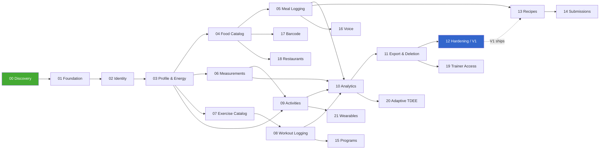

# FITTA — Phase Status and Dependency Matrix

**Last updated:** 2026-10-28

---

## Current state

|                   |                                                                                                    |
| ----------------- | -------------------------------------------------------------------------------------------------- |
| **Phase 00**      | ✅ **Approved** (2026-10-28). Assessment partially completed; Q00.2 deferred to the Phase 02 gate  |
| **Current phase** | **Phase 01 — Repository and Infrastructure** (brief approved)                                      |
| **Slice 1/5**     | ✅ Complete — workspace, shared config, TS strict, typed lint, CI                                  |
| **Slice 2/5**     | ✅ Complete — Docker Compose, Prisma, migration 0001, fail-fast env validation                     |
| **Slice 3/5**     | ✅ Complete — NestJS, exception filter, request id, helmet, `/health`, `/ready`                    |
| **Slice 4/5**     | ✅ Complete — Next.js, locale layout + RTL, proxy rewrite, typed client, `/status`                 |
| **Slice 5/5**     | ✅ Complete — Vitest, Playwright, CI database job, `docs/SETUP.md`                                 |
| **Phase 01**      | ✅ All 12 acceptance cases pass. **Awaiting the completion gate + your authorization**             |
| **Repository**    | `D:\FITTA` · git initialised on `main`, remote `YoussefHussein57/FITTA` added · **no commits yet** |
| **Blocked on**    | Phase 01 learning assessment + explicit authorization to begin Phase 02                            |

### Phase 01 acceptance cases

| #   | Case                                           | Status | Evidence                                                       |
| --- | ---------------------------------------------- | ------ | -------------------------------------------------------------- |
| 1   | Clean dependency installation succeeds         | ✅     | `pnpm install --frozen-lockfile` in CI                         |
| 2   | All packages typecheck                         | ✅     | `pnpm typecheck` — 4 packages                                  |
| 3   | Lint passes                                    | ✅     | `pnpm lint` — one root pass, typed rules + Next rules          |
| 4   | Applications build                             | ✅     | `pnpm build` — api (tsc) and web (next build)                  |
| 5   | API starts with valid environment              | ✅     | `env.spec.ts` + `pnpm env:check`                               |
| 6   | Startup fails clearly on missing configuration | ✅     | `env.spec.ts` — every invalid key reported, no value leaked    |
| 7   | Readiness fails when PostgreSQL is unreachable | ✅     | `health.integration.spec.ts` — 503 within the probe timeout    |
| 8   | Frontend fetches and displays backend status   | ✅     | 18 Playwright tests, desktop + mobile                          |
| 9   | A fresh test database can be migrated          | ✅     | CI migrates from empty; `database.integration.spec.ts`         |
| 10  | CI runs on a clean checkout                    | ✅     | Two-job workflow with a PostgreSQL service                     |
| 11  | Normal setup commands do not destroy databases | ✅     | `check:repo` — destructive scripts must be named `DESTRUCTIVE` |
| 12  | Docker services survive normal restarts        | ✅     | Named volumes; verified by `down` + `up` with data intact      |

### Test inventory (Phase 01)

| Suite       | Count  | Command                 | Needs           |
| ----------- | ------ | ----------------------- | --------------- |
| Unit        | 17     | `pnpm test`             | nothing         |
| Integration | 22     | `pnpm test:integration` | `pnpm db:up`    |
| E2E         | 18     | `pnpm test:e2e`         | built apps + DB |
| Repo checks | 5      | `pnpm check:repo`       | nothing         |
| **Total**   | **62** | `pnpm verify` + above   |                 |

### Phase 01 slice log

| Slice | Contents                                                       | Status  | Verified by                                                            |
| ----- | -------------------------------------------------------------- | ------- | ---------------------------------------------------------------------- |
| 1     | Workspace, `packages/config`, `packages/contracts`, lint, CI   | ✅ Done | `install` / `format:check` / `build` / `typecheck` / `lint` all exit 0 |
| 2     | Docker Compose (5433/5435), Prisma, migration 0001, env schema | ✅ Done | Acceptance cases 5, 6, 9, 11, 12 all verified — see §Slice 2 findings  |
| 3     | NestJS, exception filter, `/health`, `/ready`                  | ✅ Done | Acceptance case 7 verified — see §Slice 3 findings                     |
| 4     | Next.js, proxy rewrite, typed client, `/status`                | ✅ Done | Acceptance cases 4, 8 verified — see §Slice 4 findings                 |
| 5     | Vitest, Playwright, CI DB job, `docs/SETUP.md`                 | ✅ Done | All 12 acceptance cases — see §Slice 5 findings                        |

### Toolchain pinned in Slice 1

| Tool              | Version   | Note                                                              |
| ----------------- | --------- | ----------------------------------------------------------------- |
| Node              | 22.20.0   | `.nvmrc` + `engines`                                              |
| pnpm              | 11.18.0   | `packageManager` field                                            |
| TypeScript        | 5.9.3     | **Not 7.x** — `typescript-eslint@8` requires `>=4.8.4 <6.1.0`     |
| ESLint            | 10.13.0   | Upgraded from 9.39.5, which npm reports as deprecated             |
| typescript-eslint | 8.72.1    | Type-aware linting enabled                                        |
| Prettier          | 3.9.10    | Shared via `@fitta/config/prettier`                               |
| Zod               | 4.6.7     | `packages/contracts` + `apps/api` runtime dependency              |
| Prisma            | 6.19.3    | Client + CLI; build scripts allow-listed in `pnpm-workspace.yaml` |
| PostgreSQL        | 17-alpine | Docker: dev **5433**, test **5435**                               |

### Slice 2 findings

| Finding                                                                                                                                                                 | Resolution                                                                                   |
| ----------------------------------------------------------------------------------------------------------------------------------------------------------------------- | -------------------------------------------------------------------------------------------- |
| **`--locale=C` silently disables Arabic trigram search.** `similarity('كشري','كشرى')` returned 0; Latin pairs were unaffected, so the breakage looks like working code. | Locale changed to `C.UTF-8`; recorded as **ADR-012a** with measurements; Phase 04 asserts it |
| `unaccent` does not strip Arabic harakat — it is Latin-only                                                                                                             | Documented in ADR-012a; the Arabic normalizer is entirely ours                               |
| Port **5434 was already taken** by another project's container stack (`archivingsystem-postgres-1`); local PostgreSQL owns 5432                                         | Test database moved to **5435**                                                              |
| pnpm 11 uses `allowBuilds:` (a map), not pnpm 10's `onlyBuiltDependencies:` list                                                                                        | `pnpm-workspace.yaml` corrected; `@prisma/engines` added                                     |
| Nothing loads `.env` for a standalone config check                                                                                                                      | Node 22's native `--env-file-if-exists` used — no `dotenv` dependency added                  |

### Slice 3 findings

| Finding                                                                                                                                                                 | Resolution                                                                                      |
| ----------------------------------------------------------------------------------------------------------------------------------------------------------------------- | ----------------------------------------------------------------------------------------------- |
| **`NestFactory.create` installs its own body parser** with Express's 100 kB default, silently overriding the configured 256 kB limit (NFR-16)                           | `bodyParser: false` passed to the factory so exactly one parser and one limit exist             |
| **Nest module middleware registers after `main.ts`'s `app.use` calls**, so request-id ran behind the body parser and oversized requests returned `requestId: "unknown"` | Request-id converted to a plain Express handler registered first in the chain                   |
| Express body-parser errors are `http-errors`, not `HttpException`, so a 1 MB payload returned **500 INTERNAL_ERROR** instead of 413                                     | Filter now recognises the `http-errors` shape, honouring only `expose === true` and only 4xx    |
| `express` was a **phantom dependency** — imported directly but reachable only via `@nestjs/platform-express`; pnpm's isolated `node_modules` refused to resolve it      | Declared as a direct dependency. npm's flat layout would have hidden this until another machine |
| `@scarf/scarf` (install analytics, pulled in by NestJS) requested a postinstall script                                                                                  | **Denied** in `allowBuilds`, left explicit so the decision is visible rather than re-prompted   |
| helmet defaults `X-Frame-Options` to `SAMEORIGIN`; `SECURITY.md` §4 specifies `DENY`                                                                                    | `frameguard: { action: 'deny' }` — code and policy now agree                                    |
| Typed lint rejected `number` vs `HttpStatus` enum comparisons                                                                                                           | `switch` replaced with a lookup keyed by `HttpStatus`, comparisons use named numeric constants  |

### Slice 4 findings

| Finding                                                                                                                                                   | Resolution                                                                                                      |
| --------------------------------------------------------------------------------------------------------------------------------------------------------- | --------------------------------------------------------------------------------------------------------------- |
| `next build` runs **its own ESLint pass** with a different config resolution — two linters over the same files, either able to pass while the other fails | `eslint.ignoreDuringBuilds: true`; Next's own rules folded into the root config via `@fitta/config/eslint/next` |
| The build route table labels `/[locale]/status` as **● SSG**, which reads as "prerendered" but only reflects `generateStaticParams` in the parent layout  | Verified empirically instead: `cache-control: no-store`, and the page tracks the database per request           |
| `next-env.d.ts` is generated on every build and violates `triple-slash-reference`                                                                         | Added to the shared lint ignores — unfixable by definition                                                      |
| `@next/next/no-html-link-for-pages` scans for a `pages/` directory that an App Router project never has                                                   | Disabled in the shared Next config                                                                              |
| `rewrites()` declared `async` with nothing to await                                                                                                       | Returns `Promise.resolve(...)` from a sync function; Next only requires a Promise                               |
| `stylisticTypeChecked` rejects `type X = {...}` for object shapes                                                                                         | `Dictionary` converted to an `interface`                                                                        |

### Slice 5 findings

| Finding                                                                                                                                                                                        | Resolution                                                                                                     |
| ---------------------------------------------------------------------------------------------------------------------------------------------------------------------------------------------- | -------------------------------------------------------------------------------------------------------------- |
| **The test database was still running `--locale=C`.** The Slice 2 locale fix matched a comment block present only on the dev service, so test kept the broken setting while dev looked correct | `docker-compose.yml` rewritten with YAML anchors so the two services **cannot** diverge; test volume recreated |
| Tests built their own Nest pipeline, so they would have validated a different app than production runs                                                                                         | `configureApp()` extracted; `main.ts` and the HTTP suite call the identical function                           |
| `*.spec.ts` was excluded from the API tsconfig, so **test files were never typechecked**                                                                                                       | Split into `tsconfig.json` (typecheck, includes tests) and `tsconfig.build.json` (emit, excludes them)         |
| Adding `languageOptions` to the shared JS lint block **replaced** `disableTypeChecked`'s, re-enabling the project service on config files — the same spread-overwrite bug as Slice 1           | `parserOptions` now disables the project service by name rather than relying on spread order                   |
| `app.getHttpServer()` returns `any`, which spread through every HTTP assertion and left them unverified                                                                                        | Narrowed once via a typed helper; error bodies parsed through `errorEnvelopeSchema` instead of cast            |
| Playwright transpiles its config to CommonJS, where `import.meta` does not exist                                                                                                               | Dropped `cwd` entirely — `pnpm --filter` resolves the workspace from any directory                             |
| A stale API process held the Prisma query engine DLL, so `prisma generate` failed with `EPERM` (Windows locks loaded DLLs)                                                                     | Documented in `SETUP.md` §7 with the command to find and stop it                                               |

**Verified, not assumed — ADR-007's central claim:** `localhost:3001` appears in **no client
bundle**. `API_BASE_URL` is server-only, the browser calls the relative `/api` path, and the rewrite
forwards it server-side. The API's origin never reaches the client.

**Design note carried forward:** `PrismaService` does **not** call `$connect()` at boot. Eager
connection would kill the process when PostgreSQL is down, and a dead process cannot report that it
is unhealthy. Lazy connection is what makes `/ready` able to answer 503 — and what let the API
recover on its own when PostgreSQL came back, with no restart.

---

## Phase 00 deliverables

| Deliverable                              | Location                           | Status                  |
| ---------------------------------------- | ---------------------------------- | ----------------------- |
| PRD, actors, V1 scope, deferrals         | `PRD.md` §1–4                      | ✅                      |
| User stories with acceptance criteria    | `PRD.md` §5                        | ✅                      |
| Negative (attack) stories                | `PRD.md` §5.6                      | ✅                      |
| User journey diagrams                    | `PRD.md` §6                        | ✅                      |
| Nonfunctional requirements               | `PRD.md` §7                        | ✅                      |
| Open questions with safe defaults        | `PRD.md` §8                        | ✅                      |
| Domain boundary diagram                  | `ARCHITECTURE.md` §2               | ✅                      |
| Repository layout                        | `ARCHITECTURE.md` §5               | ✅                      |
| Most dangerous early design mistakes     | `ARCHITECTURE.md` §7               | ✅                      |
| 15 domains documented                    | `DATA_MODEL.md` §1–15              | ✅                      |
| Preliminary ER diagram                   | `DATA_MODEL.md` §16                | ✅                      |
| Data provenance policy                   | `DATA_MODEL.md` §4                 | ✅                      |
| Architecture decision records (13)       | `DECISIONS.md`                     | ✅                      |
| API inventory                            | `API_CONTRACTS.md` §2              | ✅                      |
| Authorization and permissions matrix     | `SECURITY.md` §2.2                 | ✅                      |
| Health-data privacy and retention policy | `SECURITY.md` §7                   | ✅                      |
| Threat model                             | `SECURITY.md` §8                   | ✅                      |
| Test strategy                            | `TEST_STRATEGY.md`                 | ✅                      |
| Risk register                            | `RISKS.md`                         | ✅                      |
| Phase dependency matrix                  | this file §2                       | ✅                      |
| Learning assessment                      | `INTERVIEW_QUESTIONS.md` §Phase 00 | ⏸ awaiting your answers |

---

## 2. Phase plan and dependency matrix

Each phase is a vertical slice: schema → API → UI → tests → docs. No phase is "backend only".

| Phase  | Name                             | Depends on     | Delivers                                                                                                                                                                          | Proves                                                                             |
| ------ | -------------------------------- | -------------- | --------------------------------------------------------------------------------------------------------------------------------------------------------------------------------- | ---------------------------------------------------------------------------------- |
| **00** | Product Discovery & Architecture | —              | This document set                                                                                                                                                                 | The domain is understood before the schema is written                              |
| **01** | Foundation & Toolchain           | 00             | pnpm monorepo, Nest + Next skeletons, `packages/contracts`, Docker Postgres (dev + test), Prisma wired, lint/typecheck/build/CI, health endpoints, env validation that fails fast | A trivial change goes green through the whole pipeline                             |
| **02** | Identity & Sessions              | 01             | `User`, `Session`, Argon2id, register/login/logout, session guard, CSRF, rate limits, auth audit, login/register UI                                                               | Two users exist and cannot see each other (the authorization harness is born here) |
| **03** | Profile, Goals & Energy          | 02             | `Profile`, `Goal`, `CalorieTarget`, pure `modules/energy`, safety bounds, onboarding flow, Arabic RTL shell                                                                       | A real calorie target derived from real inputs, with refusals that hold            |
| **04** | Food Catalog & Arabic Search     | 03             | `Food`, `FoodName`, `Nutrient`, `FoodNutrient`, `FoodPortion`, `FoodSource`, provenance, `pg_trgm` + normalization, seed catalog, search UI                                       | `كشري`/`koshary`/`كشرى` all find the dish, fast, with provenance shown             |
| **05** | Meal Logging & Daily Summary     | 04             | `MealLogEntry`, `MealLogItem` **with snapshots**, local-date bucketing, diary UI, daily totals vs target                                                                          | ADR-009 and ADR-010 hold under test: history is immutable and days are correct     |
| **06** | Body Measurements & Trends       | 03             | `BodyMeasurement`, plausibility bounds, smoothed trend, charts (RTL-correct)                                                                                                      | Weight history reads honestly, noise is labeled                                    |
| **07** | Exercise Catalog                 | 03             | `Exercise`, names, muscles, equipment, instructions, licensed media, browse UI                                                                                                    | A usable bilingual exercise reference with clean licensing                         |
| **08** | Workout Logging & Records        | 07             | `WorkoutSession`, `SessionExercise`, `ExerciseSet`, `PersonalRecord`, session UI                                                                                                  | **Deep nested authorization holds** (the RISK-01 route class)                      |
| **09** | Activities & Expenditure         | 03, 06         | `ActivityType` with cited METs, `ActivityLog`, net estimates, no auto-credit                                                                                                      | ADR-013 is visible in the product, not just the docs                               |
| **10** | Analytics (basic)                | 05, 06, 08, 09 | Trend, adherence, macro split, training volume; "not enough data yet" states                                                                                                      | Insight without invented confidence                                                |
| **11** | Account, Export & Deletion       | 02–10          | Export, deletion, consent management, retention jobs                                                                                                                              | The privacy policy is executable, not aspirational                                 |
| **12** | V1 Hardening & Launch            | 01–11          | Security review, a11y pass, load test vs NFRs, migration rehearsal, restore drill, observability                                                                                  | V1 is shippable                                                                    |
| **13** | Recipes & Custom Portions        | 04, 05         | `Recipe`, ingredients, yield, derived nutrition, user portions                                                                                                                    | Composite foods without yield errors (RISK-19)                                     |
| **14** | Community Submissions & Review   | 04, 13         | Submission queue, `content:review` role, moderation UI                                                                                                                            | Catalog grows without poisoning (RISK-04)                                          |
| **15** | Workout Programs                 | 08             | Versioned programs, enrollment pinning                                                                                                                                            | Template edits never mutate an in-flight plan                                      |
| **16** | Voice Logging                    | 05, 08, 06     | `VoiceCommand`, `VoiceDraft`, transcription adapter, approval UI                                                                                                                  | **Gated on a measured accuracy evaluation** (RISK-08)                              |
| **17** | Barcode & Packaged Products      | 04             | `Product`, GTIN resolution, scan flow                                                                                                                                             | **Gated on a licensing decision** (RISK-07)                                        |
| **18** | Restaurant Data                  | 04             | `Restaurant`, `RestaurantItem`, staleness labeling                                                                                                                                | Eating out is trackable and honestly labeled                                       |
| **19** | Trainer Access                   | 02, 11         | Scoped grants, expiry, revocation, access audit                                                                                                                                   | A trainer sees only what was granted (SECURITY §2.3)                               |
| **20** | Adaptive TDEE & Coaching         | 10             | Observed-TDEE model, plateau detection                                                                                                                                            | Supersedes ADR-013's multiplier approach                                           |
| **21** | Wearables                        | 06, 09         | HealthKit / Health Connect — **requires a native surface FITTA does not have**                                                                                                    | Deferred until that surface exists                                                 |

### Dependency graph

**V1 = phases 01 through 12.** Everything after the dotted line is post-launch.

### Why this order

- **Identity before anything user-owned.** Every subsequent phase inherits its authorization from
  phase 02. Building it late means retrofitting ownership into tables that already have rows.
- **Food catalog before meal logging.** Logging snapshots the catalog (ADR-009); you cannot snapshot
  what does not exist, and the snapshot's shape depends on the catalog's shape.
- **Measurements (06) and exercise (07) branch off 03 independently** — they share no coupling and
  could be reordered freely.
- **Workout logging (08) is placed mid-plan on purpose.** It has the deepest ownership nesting in the
  product (RISK-01), and it should land while the authorization harness is fresh and the pattern is
  still being actively exercised — not as a late addition.
- **Analytics (10) is last before hardening** because it reads from everything and would otherwise be
  rewritten each time a new source landed.
- **Export and deletion (11) require every table to exist.** A deletion routine that predates half
  the schema is a deletion routine that silently leaves data behind.

### Parallelizable work

| Can run in parallel | Why                                                                          |
| ------------------- | ---------------------------------------------------------------------------- |
| 06 and 07           | No shared tables, no shared code                                             |
| 07 and 04           | Independent catalogs, same search utility (write the normalizer once, in 04) |
| 13, 15 after V1     | Different domains                                                            |

---

## 3. Phase completion gate

Copied from `CLAUDE.md` so it is checkable in one place. A phase is **not** complete until every box
is ticked and you explicitly authorize the next phase.

- [ ] Defined requirements implemented
- [ ] Relevant tests pass — **with actual output reported**
- [ ] Lint passes
- [ ] Typecheck passes
- [ ] Build succeeds
- [ ] Migrations verified from an empty database
- [ ] Permissions and failure cases tested (the §4 matrix in `TEST_STRATEGY.md`)
- [ ] Documentation updated in the same change
- [ ] Changed files explained
- [ ] Remaining risks disclosed
- [ ] Learning assessment completed or explicitly deferred
- [ ] **You explicitly authorize proceeding**

---

## 4. Decisions still open (none block Phase 01)

| #   | Question                               | Default in use                          | Must be answered before |
| --- | -------------------------------------- | --------------------------------------- | ----------------------- |
| Q1  | Default locale                         | `ar-EG`, RTL                            | Phase 03 (UI shell)     |
| Q2  | Hosting region / PDPL residency        | EU (Frankfurt)                          | Phase 12                |
| Q3  | Transcription budget                   | None — voice is V2                      | Phase 16                |
| Q4  | Egyptian food composition table access | Assume none; USDA + recipe-calculated   | Phase 04                |
| Q5  | Email provider                         | Interface + mock now, vendor later      | Phase 02                |
| Q6  | Email verification required to log?    | No — async verification                 | Phase 02                |
| Q7  | Deployment target                      | Undecided; does not affect the model    | Phase 12                |
| Q8  | Imperial units                         | Metric storage, display preference only | Phase 03                |
| Q9  | MuscleWiki specifically?               | Assume no — curated seed                | Phase 07                |
| Q10 | Minimum age                            | 16, conservative handling under 18      | Phase 03                |
