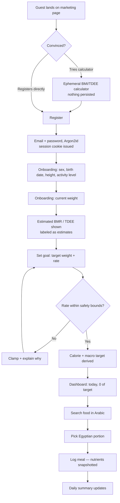
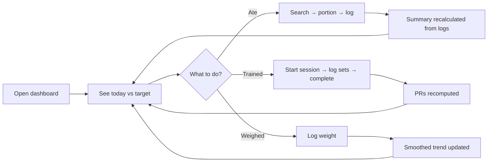
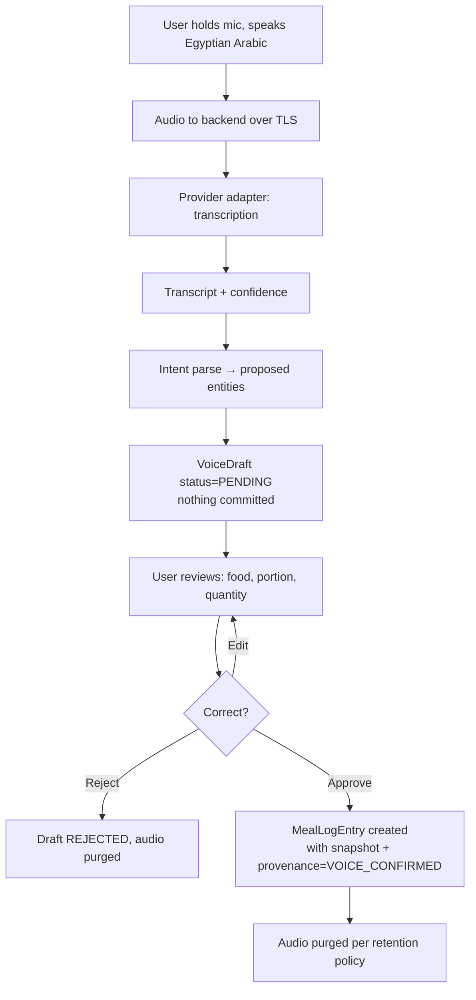

# FITTA — Product Requirements Document

**Status:** Phase 00 draft, awaiting approval
**Last updated:** 2026-10-28
**Owner:** Youssef Hussein

---

## 1. Problem statement

Egyptians who want to lose weight, build strength, or simply understand what they eat are served
badly by existing tools. Global calorie trackers (MyFitnessPal, Lose It, Yazio) fail in four
specific, compounding ways for an Egyptian user:

1. **The food is missing or wrong.** Koshary, molokhia, ful medames, taameya, feteer meshaltet,
   mahshi, roz meammar, besarah — either absent, or present only as inaccurate community entries
   copied from an American approximation of a Levantine dish.
2. **Search does not work in the user's language.** A user types `كشري` and gets nothing, because
   the catalog is indexed in English. They type `koshary` and get nothing, because the entry is
   spelled `kushari`. They type `كشرى` (ya instead of alef maqsura) and get nothing, because
   nobody normalized the Arabic.
3. **The portions are foreign.** A user does not weigh food. They eat _a plate of koshary_, _a
   loaf of baladi bread_, _a glass of tea with two spoons of sugar_, _a quarter of a farkha_.
   Grams are a unit of measurement, not a unit of thought.
4. **The nutrition has no provenance.** Every number looks equally authoritative. A value scraped
   from a user's guess in 2014 is displayed identically to a manufacturer's label. The user cannot
   tell what to trust, so eventually they trust nothing and stop logging.

FITTA exists to fix those four problems first, and to be a competent fitness tracker second.

## 2. Product principles

These are the tie-breakers when two designs are otherwise equal.

| #   | Principle                                                                                                                                              | What it rules out                                                       |
| --- | ------------------------------------------------------------------------------------------------------------------------------------------------------ | ----------------------------------------------------------------------- |
| P1  | **Egyptian-first, not Egyptian-localized.** The Arabic catalog and Egyptian portions are the primary data model, not a translation layer bolted on.    | Shipping an English catalog and adding an `ar` translation table later. |
| P2  | **Honesty about certainty.** Every nutrition number shows where it came from and how confident we are. Unknown is displayed as unknown, never as zero. | Filling gaps with plausible-looking numbers to make the UI tidy.        |
| P3  | **The user's history is immutable.** What you logged on a given day stays what you logged, even if we later correct the catalog.                       | Joining meal logs to the live catalog at read time.                     |
| P4  | **Estimates are labeled as estimates.** BMR, TDEE, 1RM, and burned calories are models, not measurements.                                              | A screen that says "You burned 412 calories."                           |
| P5  | **Safety bounds before features.** The app refuses to recommend a dangerous deficit even if the user asks.                                             | Letting a user set a 1,000 kcal/day target because they typed it in.    |
| P6  | **Authorization is a backend fact.** The server decides what you may see. The UI only decides what to render.                                          | Hiding a button and calling it access control.                          |
| P7  | **Wellness, not medicine.** FITTA screens and tracks. It does not diagnose, treat, or prescribe.                                                       | "Your BMI indicates obesity, class II."                                 |

## 3. Actors

| Actor                                            | Authenticated | Owns data                       | Core need                                                                                     | Explicit non-powers                                                                                                                                                          |
| ------------------------------------------------ | ------------- | ------------------------------- | --------------------------------------------------------------------------------------------- | ---------------------------------------------------------------------------------------------------------------------------------------------------------------------------- |
| **Guest visitor**                                | No            | No                              | Evaluate the product; try a calculator; browse the food and exercise catalogs                 | Cannot log, save, or persist anything; calculator results are ephemeral and never written to the database                                                                    |
| **Registered user**                              | Yes           | Yes                             | Track food, weight, and workouts against a goal                                               | Cannot see any other user's private data, by any route, including aggregates                                                                                                 |
| **Catalog administrator**                        | Yes           | No (operates on global data)    | Curate the global food/exercise/nutrient/portion catalogs                                     | **Cannot read any user's health data, meal logs, measurements, or profile.** Catalog power and personal-data access are deliberately separate privileges                     |
| **Content reviewer**                             | Yes           | No                              | Approve or reject community-submitted foods and recipes for promotion into the public catalog | Sees the submitted _content_ and a pseudonymous submitter handle; does **not** see the submitter's logs, weight, or profile                                                  |
| **Personal trainer** _(deferred to V2)_          | Yes           | No (operates on granted scopes) | Review an authorized client's training and, if granted, nutrition                             | Receives **only** the scopes the client explicitly granted; a client relationship grants nothing by itself; every access is logged and every grant is revocable and expiring |
| **Authorized trainer client** _(deferred to V2)_ | Yes           | Yes                             | Share a defined slice of their data with a chosen trainer                                     | — (this is a registered user in a particular state, not a separate role)                                                                                                     |

### 3.1 The administrator separation, stated as a rule

> A catalog administrator who can edit the grams-per-portion of baladi bread **must not** be able to
> read any user's weight history. These are unrelated capabilities that are conventionally bundled
> into one "admin" role, and bundling them is how fitness apps leak health data.

This is enforced as two independent permissions (`catalog:write`, `support:read_user`), not one
admin flag, and `support:read_user` is not granted to anyone in V1.

## 4. V1 scope

### 4.1 In scope for V1

| #   | Capability                                                                                                                              | Domain           |
| --- | --------------------------------------------------------------------------------------------------------------------------------------- | ---------------- |
| 1   | Email + password registration, login, logout, session management, password reset                                                        | Identity         |
| 2   | Profile: sex, birth date, height, activity level, locale, unit display preference                                                       | Profiles         |
| 3   | Goal: target weight, rate of change, with enforced safety bounds                                                                        | Profiles         |
| 4   | BMI, estimated BMR (Mifflin-St Jeor), estimated TDEE, derived calorie and macro targets                                                 | Profiles         |
| 5   | Browse and search the global food catalog in Arabic, Egyptian colloquial, English, and transliteration                                  | Food catalog     |
| 6   | Per-food Egyptian portion options (plate, loaf, glass, spoon, piece) with gram weights                                                  | Portions         |
| 7   | Log a meal by food + portion or food + grams, under a meal type and a local date                                                        | Meal logs        |
| 8   | Daily summary: calories and macros consumed vs. target, computed from logs                                                              | Summaries        |
| 9   | Log body weight and core measurements; view trend                                                                                       | Measurements     |
| 10  | Browse the global exercise catalog by muscle group and equipment                                                                        | Exercise catalog |
| 11  | Log a workout session: exercises, sets, reps, weight; view history                                                                      | Workouts         |
| 12  | Log an activity and see an **estimated, clearly labeled** energy expenditure that does **not** automatically inflate the calorie budget | Activities       |
| 13  | Basic analytics: weight trend with smoothing, calorie adherence, macro split, workout frequency and volume                              | Analytics        |
| 14  | Arabic RTL and English LTR throughout; mobile-first; WCAG 2.2 AA                                                                        | Cross-cutting    |
| 15  | Account deletion and personal-data export                                                                                               | Cross-cutting    |

### 4.2 Explicitly deferred

Deferral is a commitment, not a maybe. Each item below has a named reason.

| Capability                                 | Deferred to | Why it is not in V1                                                                                                                                               |
| ------------------------------------------ | ----------- | ----------------------------------------------------------------------------------------------------------------------------------------------------------------- |
| User-created recipes                       | V1.5        | Requires the portion and provenance models to be settled first; recipe nutrition is derived, so a wrong base model multiplies errors                              |
| Custom user portions ("my cup = 180 g")    | V1.5        | Needs real usage data to know which portions users actually miss                                                                                                  |
| Workout programs and enrollment            | V1.5        | Needs program versioning to avoid template edits mutating a user's in-flight plan; meaningless until workout logging has traction                                 |
| Community food submission and review queue | V1.5        | Requires moderation tooling and the reviewer role; V1 ships a curated seed catalog instead                                                                        |
| Egyptian Arabic voice logging              | V2          | Depends on verified transcription accuracy for Egyptian dialect, which is unproven and must be measured against a held-out evaluation set before any user sees it |
| Barcode scanning and packaged products     | V2          | Blocked on a licensing decision (Open Food Facts is ODbL — share-alike; see RISK-07)                                                                              |
| Restaurant and chain menu data             | V2          | Licensing and accuracy liability; menu data goes stale silently                                                                                                   |
| Trainer–client authorization               | V2          | The permission model must be designed before the feature; shipping it late is correct, shipping it loosely is not                                                 |
| Progress photos                            | V2          | Highest-sensitivity data in the product; requires encrypted storage, signed short-lived URLs, and a retention policy before a single byte is accepted             |
| Wearables (HealthKit / Health Connect)     | V3          | Requires native app surfaces FITTA does not have; web-only cannot integrate HealthKit                                                                             |
| Adaptive TDEE and coaching nudges          | V2          | Needs ≥8 weeks of real intake and weight data per user to be anything but noise                                                                                   |
| Social features, feeds, sharing            | Not planned | Out of product scope                                                                                                                                              |

### 4.3 Out of scope permanently

- Medical diagnosis, disease classification, or treatment recommendation.
- Eating-disorder treatment or clinical intervention.
- Supplement or medication sales.
- Any claim of clinical accuracy.

## 5. User stories

Format: _As a [actor], I want [capability], so that [outcome]._ Acceptance criteria are written as
testable assertions. `AC` items marked **SEC** become mandatory authorization tests.

### 5.1 Identity and authentication

**US-01 — Register**
As a guest, I want to create an account with my email and a password, so that my tracking is saved.

- AC1: Password is hashed with Argon2id; the plaintext never reaches storage or logs.
- AC2: Registering with an already-used email returns the **same** response shape and a response
  time within the same distribution as a fresh registration. **SEC** (enumeration)
- AC3: Passwords shorter than 10 characters are rejected with a field-level error.
- AC4: A session is established on success; the session identifier is set in an `HttpOnly`,
  `Secure`, `SameSite=Lax` cookie. **SEC**
- AC5: Registration is rate-limited per IP and per email. **SEC**

**US-02 — Log in**
As a registered user, I want to log in, so that I can reach my data.

- AC1: A wrong password and an unknown email are indistinguishable in response body, status code,
  and timing. **SEC**
- AC2: A new session identifier is issued on login; any pre-login session identifier is invalidated.
  **SEC** (session fixation)
- AC3: After N failed attempts the account enters a throttled state with increasing delay. **SEC**

**US-03 — Log out**
As a registered user, I want to log out, so that my session cannot be reused.

- AC1: The session is revoked **server-side**; the cookie is cleared.
- AC2: A request replaying the old cookie after logout receives 401. **SEC**

**US-04 — Reset password**
As a registered user who forgot my password, I want to reset it by email.

- AC1: The reset-request endpoint responds identically whether or not the email exists. **SEC**
- AC2: Tokens are single-use, expiring (≤30 min), and stored hashed. **SEC**
- AC3: Completing a reset revokes **all** of that user's existing sessions. **SEC**

### 5.2 Profile and goals

**US-05 — Complete my profile**
As a registered user, I want to enter sex, birth date, height, and activity level, so that FITTA can
estimate my energy needs.

- AC1: Height is stored in centimetres regardless of the unit entered.
- AC2: Birth date is stored; age is derived at calculation time, never stored.
- AC3: Implausible values are rejected with bounds stated in the error (height 80–250 cm).

**US-06 — See my BMI, BMR, TDEE, and targets**
As a registered user, I want to see my estimated energy needs and understand they are estimates.

- AC1: BMI is displayed with the label "screening measurement, not a diagnosis" and no disease
  classification language.
- AC2: BMR and TDEE display the formula name and the word "estimated".
- AC3: The calculation is a pure function, unit-tested against published reference values.

**US-07 — Set a weight goal**
As a registered user, I want to set a target weight and rate, so that I get a calorie target.

- AC1: Rate is capped at the lower of 1.0 kg/week and 1% of current body weight per week.
- AC2: The resulting calorie target is floored (≥1200 kcal for women, ≥1500 kcal for men) and never
  set below estimated BMR without an explicit, separate acknowledgement.
- AC3: A target weight below BMI 18.5 is refused with an explanation.
- AC4: Exactly one goal may be `ACTIVE` per user at a time.

### 5.3 Food and logging

**US-08 — Find an Egyptian food**
As a registered user, I want to find `كشري` by typing `كشري`, `كشرى`, `koshary`, `kushari`, or
`koshari`, so that logging is not a spelling exam.

- AC1: All five inputs return the same food in the first three results.
- AC2: Arabic input is normalized for alef forms, ta marbuta, alef maqsura, tatweel, and diacritics
  before matching.
- AC3: Search p95 latency ≤ 300 ms at seed-catalog scale.

**US-09 — Log food in a familiar portion**
As a registered user, I want to log "one plate of koshary", so that I don't have to weigh my food.

- AC1: Each food offers its defined portions with visible gram weights.
- AC2: The gram weight used is persisted on the log entry.
- AC3: Grams remain available as an input for users who do weigh.

**US-10 — Trust the number I'm shown**
As a registered user, I want to know where a nutrition value came from.

- AC1: Every nutrition display carries a provenance indicator.
- AC2: A nutrient with no known value renders as "—" / "unknown", never `0`.
- AC3: Community-estimated values are visually distinct from manufacturer-confirmed values.

**US-11 — My history doesn't change under me**
As a registered user, I want yesterday's log to keep yesterday's numbers even if the catalog is
corrected tomorrow.

- AC1: Nutrient values are snapshotted onto the log item at write time.
- AC2: Editing the catalog food afterwards leaves existing log items numerically unchanged.
- AC3: A test asserts this explicitly by mutating a catalog food and re-reading an old log.

**US-12 — See my day**
As a registered user, I want a daily total against my target.

- AC1: The day boundary follows the user's local date, not UTC. A meal logged at 01:00 Cairo time
  belongs to that Cairo date.
- AC2: The total is derived from the logged items and is reproducible from them.

### 5.4 Body, exercise, and activity

**US-13 — Log my weight** — AC: plausibility bounds enforced; a day-over-day change > 3 kg warns but
does not block; the trend chart uses a smoothed series and says so.

**US-14 — Browse exercises** — AC: filter by muscle group and equipment; Arabic and English names;
media carries its license and attribution.

**US-15 — Log a workout** — AC: sets record reps, weight (kg canonical), optional RPE, and a warmup
flag; a session belongs to exactly one user; nested set writes re-verify ownership at the session
level. **SEC**

**US-16 — See a personal record** — AC: PRs are derived from completed working sets; estimated 1RM
is labeled as an estimate with the formula named.

**US-17 — Log an activity** — AC: expenditure is shown as an estimate with its MET source cited;
it does **not** automatically increase the day's calorie budget.

### 5.5 Account and privacy

**US-18 — Export my data** — AC: a machine-readable export of all user-owned data, delivered through
an authenticated, expiring link.

**US-19 — Delete my account** — AC: confirmed, irreversible; user-owned rows are deleted or
irreversibly anonymized within the documented window; global catalog contributions are retained in
anonymized form; the deletion is logged.

### 5.6 Negative stories (these must fail)

These are written as stories because they must be implemented as tests.

| ID         | Story                                                      | Expected                                           |
| ---------- | ---------------------------------------------------------- | -------------------------------------------------- |
| **NEG-01** | User B requests User A's meal log by ID                    | 404 (not 403 — do not confirm existence)           |
| **NEG-02** | User B supplies `userId: A` in a create-meal-log body      | The field is ignored; the row is created for B     |
| **NEG-03** | User B edits a set inside User A's workout session         | 404                                                |
| **NEG-04** | User B enumerates sequential IDs to discover A's data      | IDs are non-sequential; enumeration yields nothing |
| **NEG-05** | A catalog administrator opens a user's measurement history | 403 — the permission does not exist for that role  |
| **NEG-06** | An expired or revoked session cookie is replayed           | 401                                                |
| **NEG-07** | A cross-site form POSTs to a state-changing endpoint       | Rejected by CSRF protection                        |
| **NEG-08** | A user sets a 900 kcal/day target                          | Refused with the safety bound explained            |

## 6. User journeys

### 6.1 New user: signup to first logged meal

### 6.2 Returning user: daily logging loop

### 6.3 Voice logging (V2) — approval is mandatory

> The draft state is not a UX nicety. It is the control that prevents a mis-transcription from
> silently writing wrong health data.

## 7. Nonfunctional requirements

| ID     | Category        | Requirement                                                                                                          | How it is verified                                          |
| ------ | --------------- | -------------------------------------------------------------------------------------------------------------------- | ----------------------------------------------------------- |
| NFR-01 | Performance     | Food search p95 ≤ 300 ms at 10k catalog entries                                                                      | Load test against seeded DB in CI                           |
| NFR-02 | Performance     | Authenticated API read p95 ≤ 400 ms, p99 ≤ 1 s                                                                       | Instrumented metrics                                        |
| NFR-03 | Performance     | Daily summary for one user-day computed in ≤ 50 ms                                                                   | Integration benchmark                                       |
| NFR-04 | Scalability     | Correct behaviour at 10k users × 365 days × ~6 log items/day (~22M rows)                                             | Index plan reviewed with `EXPLAIN ANALYZE` on seeded volume |
| NFR-05 | Availability    | 99.5% monthly for V1 (single region, no HA promise)                                                                  | Uptime monitor                                              |
| NFR-06 | Durability      | Nightly backups; RPO ≤ 24 h, RTO ≤ 4 h; restore rehearsed before launch                                              | Documented restore drill                                    |
| NFR-07 | i18n            | Full Arabic (RTL) and English (LTR); no hardcoded user-facing strings; Arabic is a first-class catalog language      | Lint rule + review                                          |
| NFR-08 | Accessibility   | WCAG 2.2 AA: keyboard reachable, visible focus, 4.5:1 contrast, labeled inputs, logical heading order                | axe in CI + manual keyboard pass                            |
| NFR-09 | Mobile          | Mobile-first; usable one-handed at 360 px width                                                                      | Playwright mobile viewport                                  |
| NFR-10 | Security        | See `SECURITY.md`; all items there are NFRs by reference                                                             | Security test suite                                         |
| NFR-11 | Privacy         | Health data classified and handled per `SECURITY.md` §retention                                                      | Policy review                                               |
| NFR-12 | Observability   | Structured JSON logs with request ID and user ID; **never** credentials, session tokens, health values, or raw audio | Log-redaction unit test                                     |
| NFR-13 | Maintainability | Lint, typecheck, build, and tests pass in CI on every PR; no `any` in domain code                                    | CI gate                                                     |
| NFR-14 | Correctness     | Every nutrition and energy calculation is a pure, unit-tested function with cited reference values                   | Unit tests                                                  |
| NFR-15 | Data integrity  | Every user-owned table has a non-null `user_id` FK and an index leading with it                                      | Schema assertion test                                       |
| NFR-16 | Limits          | JSON body ≤ 256 KB; audio upload ≤ 10 MB and ≤ 60 s (V2)                                                             | Integration test                                            |
| NFR-17 | Compliance      | Egyptian PDPL (Law 151/2018) and GDPR-aligned handling of special-category health data                               | Documented in SECURITY.md                                   |

## 8. Open questions

Each has a **safe default** that I will proceed with unless you say otherwise. None of these block
Phase 01.

| #   | Question                                                                                                 | Safe default I will use                                                                                                                                                       |
| --- | -------------------------------------------------------------------------------------------------------- | ----------------------------------------------------------------------------------------------------------------------------------------------------------------------------- |
| Q1  | Default locale — Arabic or English?                                                                      | **Arabic (`ar-EG`), RTL**, with an English toggle. "Egyptian-first" should be visible on first paint.                                                                         |
| Q2  | Where is the data hosted? PDPL has data-residency implications for health data.                          | EU region (Frankfurt) with the residency question documented as an open compliance risk (RISK-09).                                                                            |
| Q3  | Is there budget for OpenAI transcription?                                                                | Assume none for V1; voice is V2 and gated behind a verified-accuracy evaluation.                                                                                              |
| Q4  | Do you have access to an Egyptian food composition table (e.g. the National Nutrition Institute tables)? | Assume no. V1 seeds ~150–250 curated Egyptian foods: USDA (public domain) for generic components, recipe-calculated for composite dishes, every row with explicit provenance. |
| Q5  | Transactional email provider for verification and reset?                                                 | Design against an `EmailProvider` interface with a console/mock adapter; pick the vendor at Phase 01.                                                                         |
| Q6  | Is email verification required before logging?                                                           | No — verify asynchronously, but require verification before password reset and data export. Blocking signup kills activation.                                                 |
| Q7  | Deployment target?                                                                                       | Docker Compose locally; a managed Postgres + container host in production. Not decided in Phase 00; does not affect the domain model.                                         |
| Q8  | Imperial unit support?                                                                                   | Store metric always; display conversion is a presentation preference. Egypt is metric; this is low priority.                                                                  |
| Q9  | Does the user want MuscleWiki specifically, or just good exercise content?                               | Assume the latter. MuscleWiki's terms are unverified (RISK-06); V1 ships a curated seed behind a provider interface.                                                          |
| Q10 | Minimum supported age?                                                                                   | 16, with under-18 handled conservatively: no aggressive deficits. Children's growth-chart BMI is a different model and is out of scope.                                       |

---

**Approval required before Phase 01.** See `PHASE_STATUS.md` for the gate.
